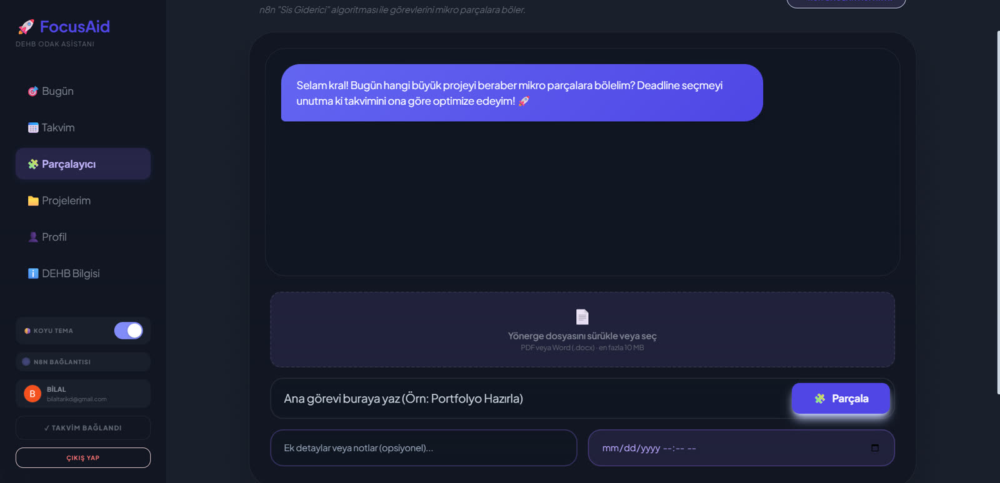
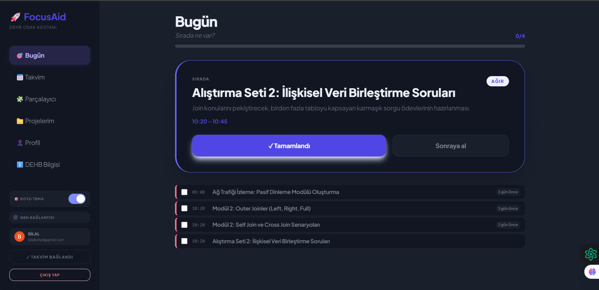
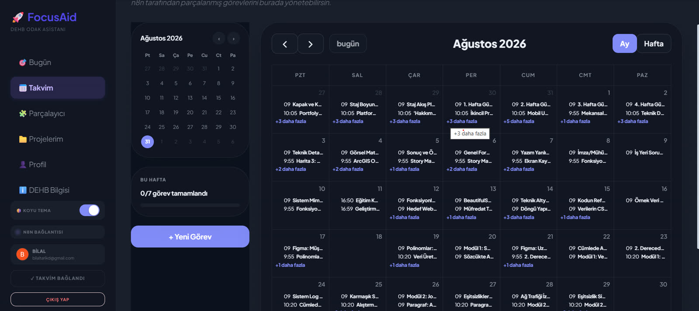
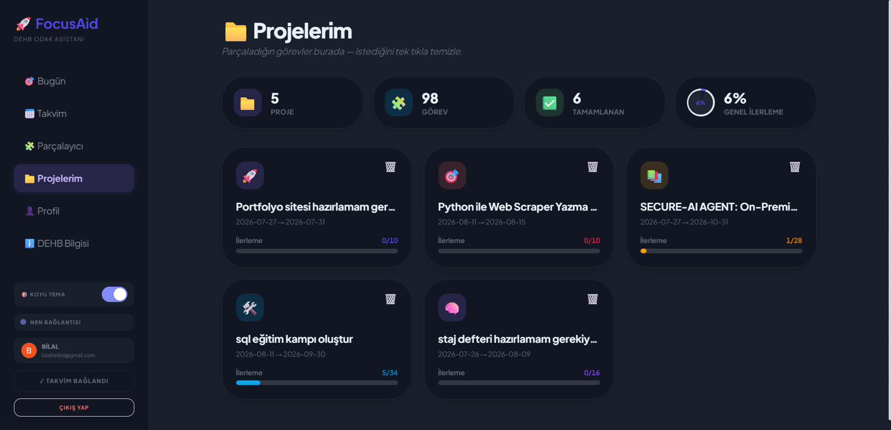
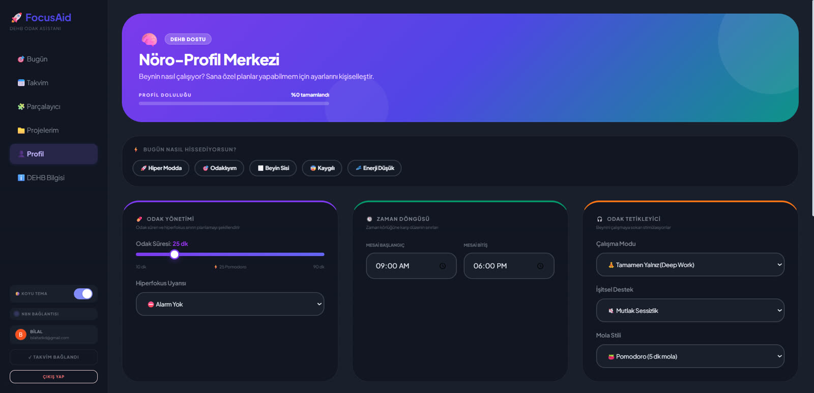

<div align="center">

# 🧠 FocusAid

### Kaostan netliğe — DEHB beyni için yapay zekâ destekli odak asistanı

**Dağ gibi görünen görevi yaz. FocusAid onu minik adımlara böler, takvimine yerleştirir,
sen sadece sıradaki tek adıma odaklanırsın.**

[](https://dehb-asistan.onrender.com)


*Kurulum yok · Google ile tek tıkla giriş · Hesapsız misafir modu*

</div>



---

## 😵 Tanıdık geldi mi?

Yapacak onlarca devasa iş, açık yüzlerce sekme ve nereden başlayacağını bilemediğin için donup
kalan bir zihin.

> *"Hepsini birden yapmam lazım ama elim hiçbirine gitmiyor..."*

Bu tembellik değil; **aşırı yüklenme felci**. DEHB'li bir beyin için "tezi bitir" bir görev
değil, aşılmaz bir duvardır. Klasik yapılacaklar listeleri bunu çözmez: yeni kurallar, yeni
disiplin, yeni suçluluk duygusu getirir.

**FocusAid sana disiplin dayatmaz. Duvarı tuğlalarına ayırır.**

## ✨ Nasıl çalışır — 3 adımda

| 1️⃣ Yaz | 2️⃣ Parçalansın | 3️⃣ Sadece sıradakini yap |
|:---:|:---:|:---:|
| Korkutucu görevi tek cümleyle yaz ya da hocanın yönerge dosyasını sürükle bırak. | Yapay zekâ işi 25–50 dakikalık mikro adımlara böler; algoritma her adımı takviminde boş bir saate yerleştirir. | Gün açıldığında karşına koca liste değil, **sıradaki tek adım** çıkar. Bitir, dopamini topla, devam et. |

> **Örnek:** *"Tezi teslim et"* → 📚 Literatür taramasında 5 makaleyi tara (35 dk) → 🧹 Anket verisini
> temizle (45 dk) → ✍️ Yöntem bölümünün ilk taslağını yaz (50 dk) … hepsi Google Takvim'inde,
> gerçek saatlerle, hiçbiri bir diğerinin üstüne binmeden.

## 🎯 DEHB beyni için tasarlandı

Her özellik tek bir soruya cevap veriyor: *"Bu, dağınık bir zihne yardım eder mi, yoksa yük mü olur?"*

### Planlama
- 🧩 **AI Parçalayıcı:** Büyük işi mikro adımlara böler, bilişsel yükünü (hafif/orta/ağır) etiketler.
  Zor adımı sabah erken saate, hafifini öğleden sonraya koyar.
- 📄 **Yönerge okuma:** Ödev/proje yönergesini (PDF veya Word) yükle; FocusAid ne istendiğini çıkarıp plana döker.
- 📅 **Google Takvim senkronu:** Adımlar takvimine otomatik düşer, dolu saatlerin üstüne asla yazmaz.
- 🌤️ **"Bugün nasılsın?" modu:** Zor bir gündesin mi? Bugünün yükü azalır, adımlar küçülür, hiçbir
  şey silinmez; taşan iş sessizce sonraki günlere yayılır, teslim tarihi kaçmaz.
- 🧬 **Nöro-Profil:** Odak süren, mola stilin, çalışma saatlerin. Plan hazır bir şablona değil,
  senin beynine göre kurulur.

### Odakta kalmak
- ⏰ **Hiperfokus alarmı:** 90 dakikadır başını kaldırmadın mı? Nazik bir şerit mola vermeni hatırlatır; sayaç tamamen tarayıcında, sunucuya hiç gitmez.
- 🧠 **Düşünce Parkı:** Seans ortasında aklına "faturayı ödemeliyim" geldi mi? 3 saniyede park et,
  odağı kaybetmeden işine dön.
- 🎧 **Odak sesleri:** Brown noise, 40 Hz binaural, lo-fi, yağmur, beyaz gürültü. Tarayıcıda üretiliyor, sınırsız döngü.
- 🟢 **Canlı çalışma odaları:** Başkalarıyla birlikte sessizce çalış (body doubling). Kamera
  zorunlu değil, herkesin hedefi kartında yazar.
- 📺 **Çalışma odaları:** "Benimle çalış" videoları uygulamanın içinde, tek tıkla.

### Motivasyon
- 🎡 **Dopamin Çarkı:** Günün tüm görevleri bitince hak ettiğin ödülü çark belirler.
- 🥊 **İnat Modu:** Hiç başlayamadığın göreve 3 dakikalık "hodri meydan". Başlamak işin en zor kısmı.
- 📊 **Çalışma Analizim:** Tahmin ettiğin süre ile gerçek süreyi karşılaştırır; planlayıcı zamanla
  seni daha iyi tanır.
- 📬 **Haftalık rapor:** Her pazartesi geçen haftanın özeti e-postanda.

### Kendini anlamak
- 📖 **DEHB Bilgi Merkezi:** Kısa, kaynaklı, sindirilebilir içerik. Uygulamanın içinde, yeni sekme
  açmadan.

## 🖼️ Ekranlar

| Bugün: sadece sıradaki adım | Takvim: gerçek saatlerle |
|:---:|:---:|
|  |  |
| **Projelerim: ilerleme tek ekranda** | **Nöro-Profil: plan sana göre** |
|  |  |

## 🚀 Hemen dene

**👉 [dehb-asistan.onrender.com](https://dehb-asistan.onrender.com)**

Google hesabınla giriş yap ya da **misafir olarak keşfet**. Kurulum yok, kredi kartı yok. Açık/koyu
tema, telefon ve masaüstü desteği var.

---

## 🛠️ Kaputun altı

FocusAid bir hafta sonu projesi değil; gerçek kullanıcı verisini taşıyan, güvenliği test edilen,
canlıda çalışan bir ürün.

```
Tarayıcı ──► serve.py (Render) ──► n8n (Oracle Cloud) ──► Gemini AI · Google Takvim · Supabase
            token doğrular,        görevi parçalar,
            kimliği sabitler,      algoritma saatlere yerleştirir
            gizli anahtarı ekler
```

| Katman | Teknoloji |
|--------|-----------|
| Arayüz | Vanilla HTML/JS · Tailwind CSS · FullCalendar · Web Audio API |
| Uygulama sunucusu | Python (`serve.py`) · Render |
| Otomasyon | n8n, Oracle Cloud'da self-hosted (Docker + Caddy + Let's Encrypt) |
| Yapay zekâ | Google Gemini (n8n AI Agent) |
| Veri & kimlik | Supabase: PostgreSQL + Row Level Security + Google OAuth |
| Canlı odalar | Jitsi (haftalık değişen HMAC tabanlı oda adları) |

**Öne çıkan mühendislik kararları**

- 🤖 **LLM planlar, algoritma yerleştirir.** Yapay zekâ yalnızca adımları ve zorluklarını üretir;
  tarih/saat yerleştirmesi test edilmiş deterministik bir algoritmada. Takvim halüsinasyonu yok.
- 🔐 **Tarayıcı hiçbir sırrı görmez.** n8n adresi ve anahtarları yalnız sunucuda; vekil her isteği
  Supabase token'ıyla doğrulayıp kullanıcı kimliğini ezer. Başkasının takvimine görev yazdırmak
  mümkün değil.
- 🛡️ **Katmanlı güvenlik:** RLS her tabloda açık ve CI'da gerçek hesaplarla test ediliyor; Google
  refresh token'ları şifreli saklanıyor; LLM çıktısı HTML'e girmeden temizleniyor; CSP,
  hız sınırlama ve haftalık Trivy taraması var.
- ✅ **377 otomatik test:** 346 JavaScript (n8n node kodu dahil) + 31 Python, artı Playwright ile
  uçtan uca arayüz testleri. Her push'ta GitHub Actions'ta koşuyor.
- ♿ **Sakinlik ilkesi:** Hareket azaltma tercihine saygı, kaydırma asla kaçırılmıyor, gereksiz
  animasyon yok. Odak sorunu olan birinin dikkatini çalmak bu ürünün amacına aykırı.

📘 Mimari, güvenlik modeli, yerel kurulum, deploy ve dosya yapısının tamamı:
**[docs/GELISTIRME.md](docs/GELISTIRME.md)**

### Yerelde çalıştır

```bash
cp config.example.js config.js   # kendi Supabase/Google değerlerini gir
python serve.py                   # http://localhost:3000
node --test                       # testler
```

Kendi n8n sunucunu kurmak için tam kit `infra/n8n/` altında (`KURULUM.md`).

---

<div align="center">

**Odaklanmak bir irade meselesi değil, doğru araç meselesi.**

[▶ FocusAid'i dene](https://dehb-asistan.onrender.com) · MIT Lisansı · Geri bildirim için [issue aç](https://github.com/Tarikd-a11b/dehb-asistan/issues)

*⚠️ FocusAid bir üretkenlik aracıdır; tıbbi teşhis veya tedavi yerine geçmez.*

</div>
